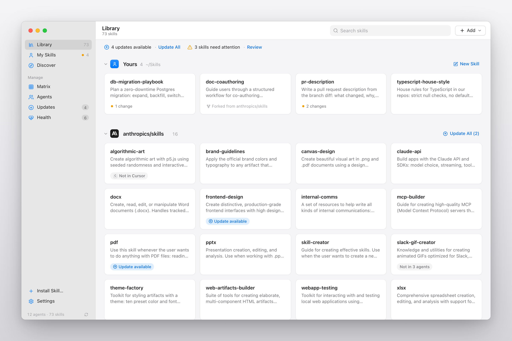
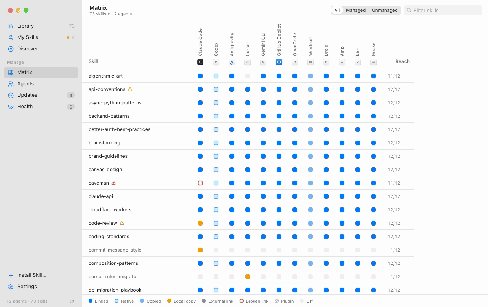

<p align="center">
  
</p>

<h1 align="center">Quiver</h1>

<p align="center">
  <b>One skill library for every AI coding agent.</b><br>
  Install a skill once and Claude Code, Codex, Antigravity, Cursor, Gemini CLI, Copilot and 60+ more agents all see it.
</p>

<p align="center">
  <a href="https://getquiver.vercel.app">Website</a> ·
  <a href="https://github.com/AnkushBL6/quiver/releases/latest">Download for macOS</a> ·
  <a href="https://github.com/AnkushBL6/quiver/releases/latest/download/Quiver-windows-x64-setup.exe">Download for Windows</a> ·
  <a href="#cli">CLI</a> ·
  <a href="#supported-agents">Supported agents</a> ·
  <a href="#how-it-works">How it works</a>
</p>

<p align="center">
  <picture>
    <source media="(prefers-color-scheme: dark)" srcset="assets/screenshot-dark.png">
    
  </picture>
</p>

---

<p align="center"></p>

## Why

Every coding agent reads [Agent Skills](https://agentskills.io) (folders with a `SKILL.md`) from **its own folder**: `~/.claude/skills`, `~/.gemini/config/skills`, `~/.cursor/skills`, `~/.factory/skills`, and so on. Install a skill for one agent and the others never see it. Update it in one place and the copies drift apart. After a few months you have dozens of duplicates, broken symlinks and skills stranded in a single tool.

Quiver fixes that, on macOS and Windows:

- **Install once, use everywhere.** Skills live in one shared store and are linked into every agent you use.
- **Universal mode.** Turn it on once and Quiver keeps every skill in every agent by itself. New installs go everywhere, a skill dropped into any one agent's folder is shared with the rest, and newly installed agents get your whole library. No per-agent checkboxes; switch a skill off for one agent only if you want an exception.
- **Your own skills, kept apart.** Skills you write live in `~/Skills`, a git repo you own. Quiver links them into every agent, never "updates" them from anywhere, shows uncommitted changes, and commits, pulls and pushes for you. Drop a folder into `~/Skills` and every agent sees it. Fork any installed skill with **Make it mine** to customise it without upstream updates overwriting your edits.
- **See everything.** A single library of every skill on your machine, with a matrix showing which agent sees what.
- **Make existing skills universal.** One click adopts skills that are stuck in one agent's folder and shares them with all the others.
- **Updates that actually work.** Quiver checks GitHub sources (one API call per repo), follows skills that moved upstream, and warns before overwriting your local edits.
- **Find lost sources.** Skills copied in by hand have no upstream, so they never update. Quiver finds where each one came from and verifies it against the repo's git tree hash, so it reports "identical to anthropics/skills" as a fact, not a guess. Then it tracks them for updates.
- **Health checks.** Finds broken links, conflicting copies and malformed `SKILL.md` frontmatter, and fixes them.
- **Install from anywhere.** `owner/repo`, GitHub URLs (tree/blob), skills.sh links, any git URL (GitLab, Bitbucket, SSH), local folders and `.zip` files. You can also drag and drop them onto the window.
- **Discover.** Search the [skills.sh](https://skills.sh) directory from inside the app.
- **Safe by design.** Nothing is deleted outright: replaced folders go to the Trash (the Recycle Bin on Windows), and every download is verified against GitHub's git blob SHA-1.
- **Fast and small.** The core is Rust and the app is built with Tauri; Quiver.app is under 7 MB on macOS. It scans 200+ skills across 70 agents in about 80 ms.

## How it works

```
                    ~/.agents/skills/            ← canonical store (one real copy)
                    ├── pdf/
                    ├── frontend-design/
                    └── my-skill/
                          ▲   ▲   ▲
   symlink / junction ────┘   │   └──── symlink / junction
~/.claude/skills/pdf    ~/.gemini/config/skills/pdf    ~/.cursor/skills/pdf   …
```

- The canonical store is `~/.agents/skills`, the same location the [`skills` CLI](https://github.com/vercel-labs/skills) uses. Codex, Cline, Warp, Zed, Pi, Kimi and other "universal" agents read it **natively**, so they need no links at all.
- Every other agent gets a link in its own skills folder: a relative **symlink** on macOS and Linux, a **junction** on Windows. Agents that don't follow links can be switched to **copy mode** in Settings, and Quiver keeps those copies in sync. See [Windows](#windows) for how links work there.
- Quiver reads and writes the shared lockfile `~/.agents/.skill-lock.json` (v3) and preserves fields it doesn't know about, so it works side by side with `npx skills`.
- Your own skills live in `~/Skills/<name>` (configurable). The store entry `~/.agents/skills/<name>` is a link to it, so agents see it through the same links as everything else while the source of truth stays in your repo.
- Quiver-only state (install hashes for local-edit detection, agents you hid a skill from, update cache) lives in `~/.quiver/`. Your GitHub token, if you add one, is stored in the macOS Keychain or Windows Credential Manager. On Windows, `~` means your user profile (`C:\Users\<you>`), so the same paths apply: `~/.claude/skills` is `%USERPROFILE%\.claude\skills`.

## Install

**macOS app:** download the `.dmg` from [Releases](https://github.com/AnkushBL6/quiver/releases/latest) (universal: Apple Silicon and Intel, macOS 12+).

**Windows app:** download `Quiver-windows-x64-setup.exe` from [Releases](https://github.com/AnkushBL6/quiver/releases/latest) (Windows 10 and 11, 64-bit). It installs for the current user, so no admin rights are needed. The installer isn't code-signed yet, so SmartScreen may show "Windows protected your PC": choose **More info → Run anyway**.

**CLI:**

```sh
cargo install --git https://github.com/AnkushBL6/quiver quiver-cli
```

or download a prebuilt binary from Releases: `quiver-cli-macos-universal.tar.gz` (macOS) or `quiver-cli-windows-x64.zip` (contains `quiver.exe`; put it on your `PATH`).

### Windows

Quiver works the same way on Windows; only the link mechanism differs, because creating symlinks there normally needs Developer Mode or admin rights.

- **Junctions first.** Each agent's skill folder is a directory *junction* pointing at the shared store. Junctions need no special permission, work on any local NTFS drive, and every agent follows them like a normal folder. `quiver doctor`, the Health view and the broken-link checks understand them exactly as they do symlinks.
- **Symlinks as a fallback**, when a junction can't be made (for example on a volume that doesn't support them but does allow symlinks).
- **Copies as a last resort.** If neither kind of link is possible, the agent's folder gets a plain copy of the skill (shown as *Copied*), so the agent still sees it. Per-agent **copy mode** in Settings does the same on purpose.
- Set `QUIVER_WINDOWS_LINKS=junction`, `symlink` or `copy` to force one strategy (default `auto`).
- Folders you delete go to the Recycle Bin. Git (for **My Skills** versioning) is found in `PATH` or the usual Git for Windows locations; install it with `winget install Git.Git`.
- Agent icons come from macOS app bundles, so on Windows agents show a lettered monogram instead.

## CLI

```sh
quiver list                       # every skill and how many agents see it
quiver agents [--all]             # detected agents and their skill folders
quiver show <skill>               # details, locations, per-agent visibility
quiver install anthropics/skills --skill pdf
quiver install https://github.com/owner/repo/tree/main/skills/foo
quiver install ./my-skills        # local folder, .zip, or any git URL
quiver adopt <skill>              # make a stranded skill universal
quiver link <skill> <agent>       # / unlink
quiver outdated && quiver update  # check and apply updates
quiver doctor [--apply]           # find and fix broken links, missing links, unmanaged skills
quiver universal on               # keep every skill in every agent automatically
quiver search <query>             # search skills.sh
quiver new <name> -d "…"          # create a skill of your own in ~/Skills
quiver mine                       # your skills: git status, last commit
quiver mine add <skill>           # make an installed skill yours (stops upstream updates)
quiver mine commit -m "…"         # / quiver mine push / quiver mine pull
quiver edit <skill>               # open in your editor
quiver list --mine
quiver sources [--apply]          # find (and track) the upstream of skills with no source
```

Every command accepts `--json`.

## Supported agents

Quiver ships with a registry of **71 agents** ([`crates/quiver-core/agents.json`](crates/quiver-core/agents.json)), including:

Claude Code (and extra `CLAUDE_CONFIG_DIR` profiles) · Codex · Antigravity (app and `agy` CLI) · Cursor · Gemini CLI · GitHub Copilot · OpenCode · Windsurf · Factory Droid · Amp · Kiro · Cline · Roo Code · Kilo Code · Continue · Goose · Qwen Code · Warp · Zed · Grok Build · OpenHands · Junie · Trae · Augment · Crush · Devin · Hermes · Pi · Kimi Code · Qoder · Mistral Vibe · and many more.

Paths come from the `skills` CLI's agent table and were **verified against the installed agent binaries** (Antigravity 2.x, for example, reads `~/.gemini/config/skills`, not the older `~/.gemini/antigravity/skills`). If an agent is missing or a path changed, edit `agents.json` and open a PR, or add a custom agent in Settings.

## Development

Requirements: Rust (stable), Node 22+, pnpm, and a C toolchain: Xcode Command Line Tools on macOS, or the Visual Studio Build Tools ("Desktop development with C++") and WebView2 on Windows.

```sh
cd app
pnpm install
pnpm tauri dev          # run the app
pnpm dev                # UI only, in the browser, against a realistic mock backend
cargo test --workspace  # core tests (uses a fake home directory)
```

Project layout:

```
crates/quiver-core   Rust library: agent registry, scanner, linker, installer, updater
crates/quiver-cli    `quiver` command-line tool
app/                 Tauri 2 desktop app (React + TypeScript UI, app/src-tauri = Rust shell)
website/             Project website
```

See [CONTRIBUTING.md](CONTRIBUTING.md).

## Roadmap

- Project-level skills (`.claude/skills`, `.agents/skills` in repos)
- `quiver://` deep links for one-click installs from websites
- Self-updating app (Tauri updater) and Homebrew cask
- Linux desktop build (the core and CLI already build there)
- Code-signing for the Windows installer
- Menu bar mode with update notifications

## License

[MIT](LICENSE)
